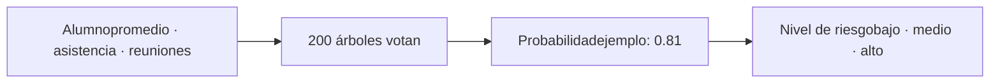
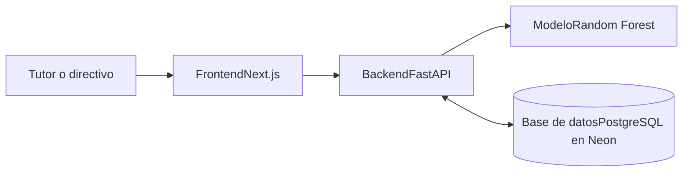

Tesis · Ingeniería de Sistemas · UCV · avance al 10 de octubre de 2026

# Web con Machine Learning para determinar el riesgo de deserción escolar

Lo que construí hasta ahora, explicado en orden: el problema, los datos, cómo se entrenó el modelo, de dónde salen los datos sintéticos, cómo se evaluó y cómo funciona la web.

- [Problema y diseño](#problema)
- [Datos de entrenamiento](#datos)
- [El modelo](#modelo)
- [Datos sintéticos](#sinteticos)
- [Evaluación](#evaluacion)
- [Niveles de riesgo](#niveles)
- [Preprueba 2026](#pre)
- [La web](#web)
- [Limitaciones](#limites)
- [Qué sigue](#siguiente)

1 · Punto de partida

## El problema y el diseño de la investigación

En la institución educativa de Comas el seguimiento de los estudiantes en riesgo era **reactivo**: el riesgo se detectaba cuando el alumno ya se había ido. La deserción reportada subió de 29 % en 2024 a 35 % en 2025, y no existía ninguna herramienta que anticipara quiénes estaban en riesgo.

Mi propuesta es una web que usa **Machine Learning** para estimar el nivel de riesgo de cada estudiante (bajo, medio o alto) con tres indicadores, uno por dimensión de la variable:

| Dimensión | Indicador | Fórmula |
| --- | --- | --- |
| Rendimiento académico | Promedio de calificaciones | Σ notas ÷ n (escala 0–20) |
| Asistencia escolar | % de asistencia | días asistidos ÷ días programados × 100 |
| Apoyo familiar | % de asistencia a reuniones | reuniones asistidas ÷ programadas × 100 |

### Diseño cuasiexperimental

Trabajo con dos secciones ya formadas, sin sorteo: **4.° B como grupo experimental** (sus tutores usarán la web) y **3.° A como grupo control** (seguimiento habitual, sin la web). A ambos los mido antes y después de la intervención con las mismas tres fichas de registro.

**35**control, 3.° A

**34**experimental, 4.° B

**1**excluido por traslado definitivo

Antes de intervenir comprobé que los dos grupos parten igual. Con la prueba U de Mann-Whitney no hay diferencia en el promedio (p = 0.540), en la asistencia (p = 0.449), en las reuniones (p = 0.616) ni en el nivel de riesgo (p = 0.864). Eso es lo que permite atribuir a la web las diferencias que aparezcan después.

2 · Datos con los que se entrena

## Qué datos usé para entrenar el modelo

Un modelo supervisado necesita ejemplos donde ya se conoce la respuesta. Usé un **registro histórico de la institución con 70 estudiantes de 3.° y 4.° de secundaria** (35 por sección) de los que se sabe si desertaron o no. Los datos están anonimizados con códigos (EST-001 en adelante), sin nombres ni DNI, conforme a la Ley N.° 29733.

**70**estudiantes reales

**13**desertores (18.6 %)

**57**no desertores

Cada estudiante tiene sus 10 notas (una por área), 45 días programados en el I bimestre y 2 reuniones de padres programadas. De ahí se calculan los tres indicadores con las fórmulas de la tesis.

### Un corte importante: el I bimestre

Todos los indicadores se calculan solo con lo ocurrido hasta el cierre del **I bimestre**, en el histórico y en 2026 por igual. Si usara el año completo, un alumno que se fue a mitad de año tendría pocas asistencias porque ya se había ido, y el modelo aprendería la consecuencia de la deserción en vez de sus señales tempranas. Eso se llama fuga de información. Los desertores del histórico dejaron de asistir después del I bimestre, así que no hay fuga.

### Cómo se diferencian los desertores

Mediana de cada indicador y valor p de Mann-Whitney:

| Indicador | Desertó (13) | No desertó (57) | p |
| --- | --- | --- | --- |
| Promedio | 10.60 | 14.80 | 0.003 |
| % asistencia | 28.89 | 64.44 | \< 0.001 |
| % reuniones | 0.00 | 50.00 | \< 0.001 |

Los tres indicadores distinguen a quienes desertaron. La asistencia es la que más los separa, y ningún desertor tuvo padres que asistieran a una reunión.

3 · El algoritmo

## El modelo: Random Forest

Usé un **Random Forest** (bosque aleatorio) de scikit-learn, un algoritmo de aprendizaje supervisado. Es un conjunto de 200 árboles de decisión. Cada árbol aprende de una muestra distinta de alumnos y hace preguntas del tipo “¿la asistencia es menor a 40 %?” para separar desertores de no desertores. Para un alumno nuevo, cada árbol vota y la **probabilidad de deserción** es la proporción de árboles que votan “deserta”.

Planteé el problema como una clasificación binaria (desertó sí o no) y no directamente en tres niveles, porque el dato que la institución registra es si el alumno desertó. Los niveles se obtienen después, cortando la probabilidad. Así no invento etiquetas de “riesgo medio” que nadie registró.

### Configuración

200 árboles, hojas de al menos 2 alumnos para no memorizar casos individuales, y pesos balanceados por clase para que un desertor no detectado pese más que un falso aviso. Probé una búsqueda de hiperparámetros con validación cruzada anidada y no mejoró nada, así que dejé la configuración inicial, que es la más simple.

4 · Datos sintéticos

## De dónde salen los datos sintéticos y por qué los usé

Con 13 desertores el modelo tiene muy pocos ejemplos de la clase que más importa. Siguiendo la indicación del docente de que es válido generar datos sintéticos para entrenar, apliqué **aumento de datos** sobre los 70 estudiantes reales.

### SMOTE, el método que usé

SMOTE (Chawla et al., 2002) crea estudiantes nuevos **interpolando entre estudiantes reales parecidos de la misma clase**: toma un alumno real, busca a sus 5 vecinos más cercanos de su misma clase y crea uno nuevo en un punto del segmento que los une. Un sintético desertor siempre nace entre desertores reales; nunca inventa algo fuera de lo observado.

Posiciones ilustrativas. El sintético cae sobre el segmento entre dos desertores reales.

Usé un **factor 2**: dos sintéticos por cada estudiante real, en cada clase, de modo que la proporción de desertores no cambia. En el modelo final son 70 reales y 140 sintéticos.

### CTGAN, el método que comparé y descarté

Como el docente mencionó las redes generativas, también probé CTGAN (Xu et al., 2019), una GAN para datos tabulares: un generador crea registros falsos y un discriminador intenta distinguirlos de los reales. Comparé los tres escenarios con la misma validación, evaluando siempre con estudiantes reales:

| Escenario | AUC | F1 | Recall | Precisión |
| --- | --- | --- | --- | --- |
| Sin aumento | 0.994 | 0.927 | 1.000 | 0.883 |
| **SMOTE (elegido)** | 0.993 | 0.911 | 0.967 | 0.893 |
| CTGAN | 0.985 | 0.859 | 0.960 | 0.824 |

CTGAN rindió peor y, además, sus sintéticos no se parecen a los reales: con solo 13 desertores no logró aprender su distribución. Por ejemplo, generó desertores con 27 % de asistencia a reuniones promedio, cuando los reales tienen 0 %. Con el estadístico de Kolmogorov-Smirnov, que mide qué tan distinta es una distribución de otra (0 es idéntica y 1 totalmente distinta), SMOTE se mantuvo por debajo de 0.20 y CTGAN llegó a 0.73. Una GAN necesita muchos más datos que estos. Elegí SMOTE porque no empeora al modelo y sus sintéticos son fieles, y reporto CTGAN como alternativa evaluada y descartada con evidencia.

Regla central: los datos sintéticos solo se usan para entrenar. Nunca para evaluar ni como resultado.

Para cumplirla, el aumento se aplica **dentro de cada partición de entrenamiento** de la validación cruzada. Si un sintético naciera de un alumno que está en la parte de prueba, el modelo vería a ese alumno disfrazado y las métricas saldrían infladas. Todas las métricas que presento se calcularon únicamente con estudiantes reales.

5 · Cómo se evaluó

## Evaluación del modelo

Un modelo no se evalúa con los mismos alumnos con los que aprendió. Usé dos formas de separar los datos.

**Validación cruzada estratificada 5×5, la métrica principal.** Divido a los 70 estudiantes en 5 partes que mantienen la proporción de desertores. Entreno con 4, pruebo con la restante y roto las 5; luego repito todo 5 veces con repartos distintos. Son 25 evaluaciones y reporto la media y la desviación. Con solo 13 desertores, es más confiable que separar una sola vez.

| Métrica | Media | ± Desviación | Qué responde |
| --- | --- | --- | --- |
| Recall | 0.967 | 0.116 | De los que desertaron, cuántos detectó |
| Precisión | 0.893 | 0.180 | De los que marcó en riesgo, cuántos lo estaban |
| F1 | 0.911 | 0.128 | Balance entre las dos anteriores |
| Accuracy | 0.966 | 0.050 | Aciertos sobre el total |
| AUC-ROC | 0.993 | 0.015 | Capacidad de ordenar bien a desertores y no desertores |

El **recall** es la métrica que más me importa: un falso negativo es un alumno en riesgo que la web no detectó y podría desertar sin intervención. Un falso positivo solo genera un seguimiento innecesario.

**Holdout 80/20, como complemento.** Aparté al azar el 20 % (14 estudiantes, 3 desertores) para probar. El modelo identificó a los 3 desertores y erró en un solo no desertor, que marcó como riesgo. Es un conjunto de prueba muy pequeño y por eso no lo uso como métrica principal.

| Matriz de confusión | Predijo: no deserta | Predijo: deserta |
| --- | --- | --- |
| Real: no desertó | 10 | 1 |
| Real: desertó | 0 | 3 |

### Qué indicadores pesan más

Con importancia por permutación (cuánto empeora el modelo si desordeno una variable): **asistencia 0.42**, **reuniones 0.33** y **promedio cercano a 0**. El promedio sí se relaciona con la deserción (los desertores tienen peor promedio), pero cuando el modelo ya conoce la asistencia y las reuniones, el promedio casi no agrega información nueva.

### El modelo que usa la web

Después de evaluar, reentrené la misma configuración con los **70 estudiantes reales y sus 140 sintéticos** para que el modelo final aproveche los 13 desertores. Ese es el modelo en producción (`rf_v4`). Las métricas anteriores describen este procedimiento evaluado con alumnos que no vio.

6 · De probabilidad a nivel

## Cómo se definen bajo, medio y alto

El modelo entrega una probabilidad entre 0 y 1. La web la convierte en tres niveles con dos cortes, y ambos salen de los datos, no son arbitrarios. Los calculé con las probabilidades de cada alumno del histórico cuando fue evaluado por modelos que no lo habían visto.

- Alto, desde 0.50 Es el corte con el que el clasificador decide “deserta”, así que el nivel alto coincide con las métricas reportadas. Con él se identificaron los 13 desertores del histórico con solo 2 falsos positivos.
- Medio, de 0.15 a 0.50 El 0.15 es el percentil 90 de la probabilidad de los no desertores: solo 1 de cada 10 alumnos que no desertó lo supera. Es una franja de seguimiento preventivo, no una predicción de deserción.
- Bajo, menos de 0.15 Donde quedó el 90 % de los no desertores.

7 · Aplicado a la muestra

## Resultado en la preprueba 2026

Con el modelo ya entrenado clasifiqué a los 69 estudiantes de la muestra con sus datos del I bimestre 2026. Esta es la línea base antes de la intervención:

| Grupo | Bajo | Medio | Alto |
| --- | --- | --- | --- |
| Control · 3.° A (35) | 28 (80.0 %) | 6 (17.1 %) | 1 (2.9 %) |
| Experimental · 4.° B (34) | 27 (79.4 %) | 4 (11.8 %) | 3 (8.8 %) |

Cuando se mida la posprueba, usaré **el mismo modelo sin reentrenarlo** para que la comparación sea válida: el termómetro no puede cambiar entre la primera y la segunda medición. Lo que espero ver es que el grupo experimental reduzca sus casos de riesgo medio y alto más que el grupo control.

8 · El sistema

## La web

La web tiene las tres partes que declaré en la tesis: frontend, backend y base de datos, con el modelo como componente del backend.

1. El tutor registra los datos de un estudiante, o sube un archivo CSV con muchos.
2. El sistema valida los datos y calcula los tres indicadores con las fórmulas de la tesis.
3. El modelo calcula la probabilidad y el sistema la traduce a bajo, medio o alto.
4. El panel muestra a cada estudiante con su nivel y su color, con resumen por grupo y filtros.

Cada alumno puede tener un registro de preprueba y otro de posprueba, de modo que ambas mediciones se comparan en el mismo sistema. Ya cargué la preprueba de los 69 estudiantes a través de la propia web y verifiqué que quedó guardada en la base de datos.

### Seguridad y privacidad

Solo guarda códigos anónimos, nunca nombres ni DNI. El acceso es con usuario y contraseña propios: las contraseñas se guardan cifradas con Argon2id, la sesión usa un token firmado con vencimiento de 8 horas, hay bloqueo temporal tras 5 intentos fallidos y no existe registro público: yo creo las cuentas. Los datos reales de estudiantes no se publican en el repositorio.

9 · Con honestidad

## Limitaciones que declaro

- **Muestra pequeña:** un solo año de histórico y 13 casos de deserción. Por eso usé aumento de datos y validación cruzada, pero no reemplazan a más datos reales.
- **Métricas muy altas:** en el histórico las clases casi se separan solas por asistencia y reuniones, de modo que cualquier modelo rendiría cerca del máximo. Las presento como validación interna. La validación con alumnos que el modelo nunca vio llegará con la deserción real de 2026.
- **Diferencia de tasas:** la deserción en la muestra histórica (18.6 %) es menor que la institucional (29 %), lo que limita cuánto se puede generalizar.
- **Datos sintéticos:** son un apoyo al entrenamiento, no evidencia. Se declaran en Metodología y nunca se reportan como hallazgos.
- **Grupos intactos:** al ser cuasiexperimental no hay sorteo, y los grupos son de grados distintos. Lo compensa haber demostrado que parten equivalentes en la preprueba.

10 · Estado

## Dónde estamos y qué sigue

**FASE 0 ✓**Documentación y arquitectura

**FASE 1 ✓**Fichas y datos PRE

**FASE 2 ✓**Histórico de entrenamiento

**FASE 3 ✓**Modelo y umbrales

**FASE 4 ✓**Backend y base de datos

**FASE 5 ✓**Frontend

**FASE 6**Despliegue e intervención

**FASE 7**Recolección POST

**FASE 8**Análisis estadístico

**FASE 9**Resultados y Discusión

La parte técnica está completa: el modelo está entrenado y evaluado, y la web funciona con la preprueba cargada. Lo que sigue es:

1. Publicar la web en internet y crear cuentas solo para los tutores del grupo experimental.
2. Definir con la institución y con usted las fechas de inicio y fin de la intervención y el corte de la posprueba.
3. Recoger la posprueba de ambos grupos con las mismas fichas.
4. Hacer el análisis estadístico (normalidad, contraste control contra experimental) y redactar Resultados y Discusión.

Hay dos puntos que me gustaría consultarle: si la variable que se contrasta para la hipótesis general es el nivel de riesgo y si además conviene comparar la preprueba con la posprueba dentro de cada grupo.

Este documento solo contiene cifras agregadas; no incluye datos individuales de estudiantes. Los datos sintéticos se usaron únicamente para entrenar el modelo.